<div align="center">


<a href="https://git.io/typing-svg">
  
</a>

<p>
  <a href="https://github.com/manit6752025"></a>
  <a href="https://github.com/manit6752025/AXIOM-AI"></a>
  <a href="https://github.com/netcore-technologies/boxr"></a>
  <a href="https://github.com/NetCore-Technologies/wifi-analyzer-pro"></a>
  <a href="https://github.com/NetCore-Technologies/quantumgrid-os"></a>
</p>

### *“A Random Person Exploring The Whereabouts of Technological Advancement and Peace.”*

</div>

---

## `whoami` — Hello, world 👋

I'm **Manit Arora**, a developer and tech enthusiast who likes figuring out how things work, making them better, and occasionally finding out the bug was one missing character all along.

I mostly work with **Python, TypeScript, Linux, and networking**, and I'm currently learning **Go** and **Rust**. I like projects that are useful, testable, and documented, not just good-looking in a screenshot.

- 🧠 **AXIOM-AI**: an AI experimentation and workflow platform.
- 📦 **boxr** and 🧩 **QuantumGrid OS**: systems and networking projects under NetCore Technologies.
- 📡 **WiFi Analyzer Pro**: wireless-network visibility.
- 🏢 Running **NetCore Technologies**, the company behind it all.
- 🔧 Into Linux, Wi-Fi, DNS, routers, diagnostics, and self-hosting.
- 🐹🦀 Learning **Go** and **Rust**.
- 🛠️ Big on turning ambitious roadmaps into working features, not just checkboxes.
- 🌙 Most productive when the world gets quiet and the coffee gets suspiciously cold.
- 🏃 Known to disappear before a deadline. This is either time management or a very advanced stealth feature.

> **Current operating mode:** `coffee.service` active · `sleep.service` not found · `deadline.timer` enabled

---

## 🚀 Featured projects

### 🧠 [AXIOM-AI](https://github.com/manit6752025/AXIOM-AI)

**Know what fits before you train.** Inspect models, clean JSONL datasets, check VRAM/RAM fit, and run local LoRA fine-tuning or MCP servers.

- **Focus:** Local-first AI workflows, dataset analysis, model experimentation, evaluation, and diagnostics.
- **Approach:** Everything is discoverable in the GUI (`axiom gui`), while the CLI stays useful for automation and advanced workflows.
- **Goal:** A maintainable, documented platform where features are testable and the roadmap reflects reality.

[](https://github.com/manit6752025/AXIOM-AI/stargazers)
[](https://github.com/manit6752025/AXIOM-AI/releases)
[](https://github.com/manit6752025/AXIOM-AI/issues)

⭐ **Like it? [Star AXIOM-AI](https://github.com/manit6752025/AXIOM-AI) to follow along.**

### 📦 [boxr](https://github.com/netcore-technologies/boxr)

**A daemonless mini Docker engine built from scratch in Go** using Linux namespaces, cgroups v2, and OverlayFS.

[](https://github.com/netcore-technologies/boxr/stargazers)
[](https://github.com/netcore-technologies/boxr/issues)

⭐ **Into containers and Linux internals? [Star boxr](https://github.com/netcore-technologies/boxr).**

### 📡 [WiFi Analyzer Pro](https://github.com/NetCore-Technologies/wifi-analyzer-pro)

A real-time WiFi diagnostic dashboard with a Python backend and React frontend. See the [roadmap](https://github.com/NetCore-Technologies/wifi-analyzer-pro/blob/main/ROADMAP.md) for what's coming next.

[](https://github.com/NetCore-Technologies/wifi-analyzer-pro/stargazers)
[](https://github.com/NetCore-Technologies/wifi-analyzer-pro/issues)

⭐ **Want to see it live? [Star WiFi Analyzer Pro](https://github.com/NetCore-Technologies/wifi-analyzer-pro).**

### 🧩 [QuantumGrid OS](https://github.com/NetCore-Technologies/quantumgrid-os)

**An intelligent, high-performance network OS for Qualcomm routers** built around gaming, Wi-Fi, 5G, and hardware acceleration.

[](https://github.com/NetCore-Technologies/quantumgrid-os/stargazers)
[](https://github.com/NetCore-Technologies/quantumgrid-os/issues)

⭐ **Star [QuantumGrid OS](https://github.com/NetCore-Technologies/quantumgrid-os) if router firmware is your thing.**

### 🏢 [NetCore Technologies](https://github.com/Netcore-Technologies)

My company, home to **boxr**, **QuantumGrid OS** and more. Everything under the organization lives at [github.com/Netcore-Technologies](https://github.com/Netcore-Technologies).

[](https://github.com/Netcore-Technologies)

---

## 🧰 Technologies & tools

<div align="center">


</div>

| Area | Interests |
|---|---|
| **Languages** | Python, TypeScript, JavaScript, Bash, Go (learning), Rust (learning) |
| **AI & data** | Model workflows, dataset tooling, evaluation, experimentation |
| **Frontend** | React, Vite, HTML, CSS, accessible interfaces |
| **Backend & tooling** | APIs, CLI design, diagnostics, automated testing |
| **Systems** | Linux, containers (namespaces, cgroups v2, OverlayFS), networking, DNS, Wi-Fi, OpenWrt, self-hosting |
| **Engineering habits** | Git, documentation, reproducible builds, tests, release workflows |

*This is a snapshot of the tools and areas I work with and explore—not a claim of equal expertise in every item.*

---

## 📈 GitHub activity

<div align="center">


<br/>


<br/>


<br/>

<picture>
  <source media="(prefers-color-scheme: dark)" srcset="https://raw.githubusercontent.com/manit6752025/manit6752025/output/pacman-contribution-graph-dark.svg"/>
  
</picture>

<picture>
  <source media="(prefers-color-scheme: dark)" srcset="https://raw.githubusercontent.com/manit6752025/manit6752025/output/breakout-contribution-graph-dark.svg"/>
  
</picture>

<picture>
  <source media="(prefers-color-scheme: dark)" srcset="https://raw.githubusercontent.com/manit6752025/manit6752025/output/galaga-contribution-graph-dark.svg"/>
  
</picture>

<br/>

<h3>🏢 NetCore Technologies</h3>


</div>

### 📊 Repository activity

| Repository | Commits / month | Stars | Latest release | Issues |
|---|---|---|---|---|
| **AXIOM-AI** |  |  |  |  |
| **boxr** |  |  |  |  |
| **WiFi Analyzer Pro** |  |  |  |  |
| **QuantumGrid OS** |  |  |  |  |

<div align="center">


</div>

> Stats cards and trophies are generated by a GitHub Action and refresh every hour, rebuilt from scratch on each run. Commit totals count every non-merge commit on every branch of my repos and of NetCore-Technologies, counted once even if it sits on several branches. The NetCore cards also include my personal commits, merged PRs and contributions, since I'm the only member. Stars, repos and followers include my personal account and NetCore-Technologies, which also has its own set of cards above. Merged PRs are public pull requests I authored that were merged.

---

## 🏆 Achievements & open-source

<div align="center">


<br/>

<a href="https://github.com/manit6752025?tab=achievements"></a>
<a href="https://hackerone.com/manit6752025"></a>
<a href="https://github.com/Netcore-Technologies"></a>

</div>

| | Highlight | Where |
|---|---|---|
| 🧠 | Building **AXIOM-AI**, an AI engineering platform | [Repo](https://github.com/manit6752025/AXIOM-AI) |
| 📦 | Shipping **boxr** under NetCore Technologies | [Repo](https://github.com/netcore-technologies/boxr) |
| 📡 | Created **WiFi Analyzer Pro** for wireless visibility | [Repo](https://github.com/NetCore-Technologies/wifi-analyzer-pro) |
| 🧩 | Developing **QuantumGrid OS** | [Repo](https://github.com/NetCore-Technologies/quantumgrid-os) |
| 🔐 | Security research and responsible disclosure | [HackerOne](https://hackerone.com/manit6752025) |
| 🏢 | Founded and run **NetCore Technologies** | [Org](https://github.com/Netcore-Technologies) |

> 🐛 Open an issue on any project for a useful idea, reproducible bug report, or improvement.

<div align="center">

</div>

---

## 🌌 Beyond the terminal

I enjoy exploring the intersection of technology and curiosity: how systems behave, how networks can be improved, how AI tools can become more practical, and how open-source projects can turn ambitious ideas into real software.

The goal isn't to know everything. It's to keep asking better questions, build things that teach me something, and leave the codebase a little better than I found it.

```text
$ axiom status
AI experiments       : ongoing
Open-source projects : compiling (AXIOM-AI, boxr, WiFi Analyzer Pro, QuantumGrid OS)
Network curiosity    : 100%
Learning             : Go, Rust
Coffee level         : critically important
Sleep                : optional (not recommended)
Deadline camouflage  : enabled
Peace                : still being explored
```

---

## 🤝 Connect

<div align="center">

<a href="https://github.com/manit6752025">
  
</a>
<a href="https://www.linkedin.com/in/manit-arora-a4756141b/">
  
</a>
<a href="mailto:manit672025@gmail.com">
  
</a>
<a href="https://github.com/manit6752025/AXIOM-AI">
  
</a>
<a href="https://github.com/netcore-technologies/boxr">
  
</a>

### *Build with curiosity. Debug with patience. Ship with purpose.*

**Powered by coffee, late-night peace, and the occasional “crashouts”**

</div>

<div align="center">


</div>

<div align="center">
<sub>Built by <a href="https://github.com/manit6752025">@manit6752025</a></sub>
</div>
